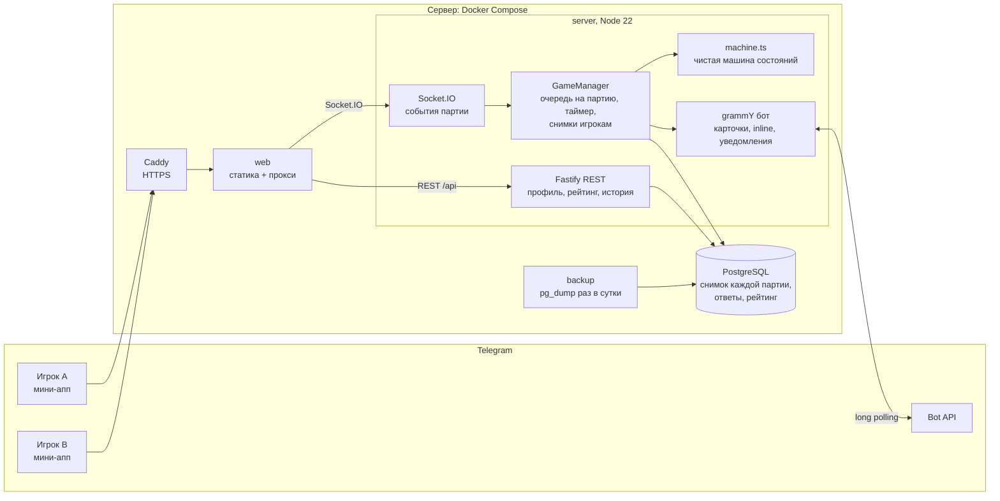
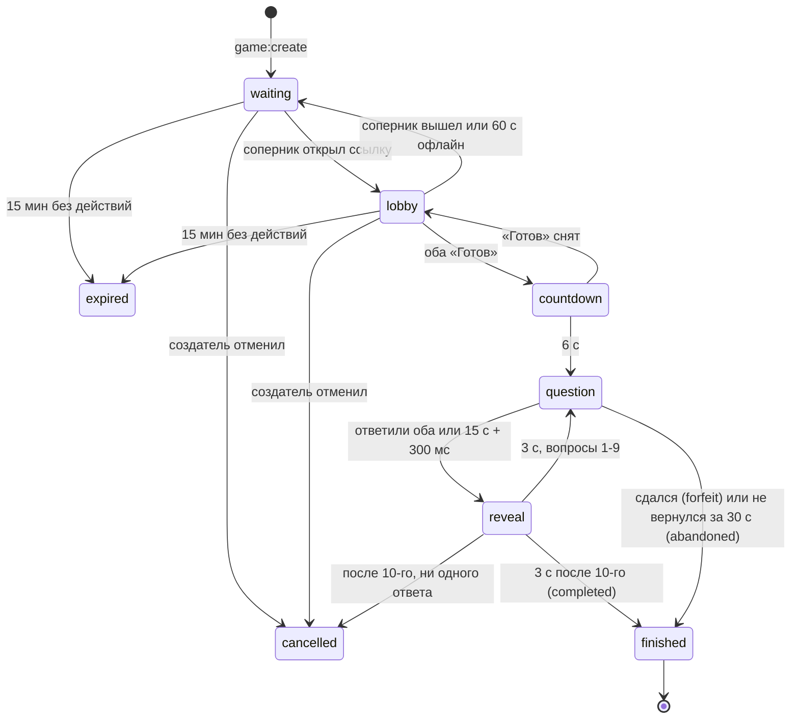

# Quiz Duel

Telegram Mini App: викторина 1 на 1 в реальном времени - кинул ссылку в чат, кто первым открыл, тот и соперник.

> **Готово.** Сделаны все 9 пунктов ТЗ и «Обновление 2.0»: монеты и магазин, реклама, оплата звёздами,
> режимы и настройки партии, друзья и рефералы, платные темы, админка с аналитикой, анимированные сообщения бота.

**Играть: [@q_battle_bot](https://t.me/q_battle_bot)** · мини-апп сразу: [t.me/q_battle_bot/QuizDuel](https://t.me/q_battle_bot/QuizDuel)

Как сыграть: откройте бота → «Создать дуэль» → категория → «Пригласить» → отправьте карточку другу.
Можно и без друга: «Быстрая игра» (случайный соперник по рейтингу) или «Тренировка».

### Проверить за 5 минут, без своего бота

1. **В Telegram**: [@q_battle_bot](https://t.me/q_battle_bot) → «Тренировка» - партия на 10 вопросов без соперника.
   Дуэль: «Создать дуэль» и откройте ссылку со второго аккаунта (или с телефона и Telegram Desktop) - кто открыл
   первым, тот соперник; оба «Готов» → 10 вопросов → итоги и «Реванш».
2. **Сервер живой**: [quiz.aidcrypto.blog/api/health](https://quiz.aidcrypto.blog/api/health) - база, бот
   (`polling`), время последней резервной копии базы (`backupAgoSec`).
3. **CI**: [GitHub Actions](https://github.com/ilyaremix/quiz-duel/actions) - на каждый коммит типы, ESLint, Prettier,
   тесты (с настоящим Postgres), сборка и оба Docker-образа с проверкой на чистой машине.
4. **Тесты у себя** (Node 22, без бота и базы - тесты на Postgres пропускаются):
   `npm ci && npm run db:generate && npm run typecheck && npm test`.
5. **Где что в коде** - таблицы ниже, по каждому пункту ТЗ: файл и тест.

## Что сделано: исходное ТЗ

| # | Пункт ТЗ | | Где в коде | Тесты |
|---|---|:---:|---|---|
| 1 | Игрок создаёт игру, получает ссылку и кидает её в чат. Ссылка сразу открывает эту игру | ✅ | Ссылка `t.me/q_battle_bot/QuizDuel?startapp=g_<id>` - [`links.ts`](packages/shared/src/links.ts); `GameManager.create` - [`manager.ts`](apps/server/src/game/manager.ts); карточка «Вызов на дуэль» для `shareMessage` - [`bot/index.ts`](apps/server/src/bot/index.ts); вход по `start_param` - [`App.tsx`](apps/web/src/App.tsx) | [`manager.test.ts`](apps/server/test/manager.test.ts) «создание и ссылка», [`socket.test.ts`](apps/server/test/socket.test.ts) «создание → вход по ссылке → «Готов» у обоих» |
| 2 | Кто первым перешёл по ссылке, тот и соперник. Партия начинается, когда оба нажали «Готов» | ✅ | `join` и `setReady` в машине состояний - [`machine.ts`](apps/server/src/game/machine.ts); все изменения партии идут по очереди - `manager.ts` | `manager.test.ts` «двое открыли ссылку одновременно», «третий открыл ссылку», «оба готовы - отсчёт» |
| 3 | 10 вопросов, на каждый 15 секунд и 4 варианта. Вопросы у обоих одинаковые, база из 100 вопросов | ✅ | [`data/questions.json`](data/questions.json) (180 вопросов RU/EN: 100 в 5 темах ТЗ и 80 в платных темах 2.0), подбор - [`picker.ts`](apps/server/src/game/picker.ts), тайминги - [`scoring.ts`](packages/shared/src/scoring.ts) | [`questions.test.ts`](packages/shared/test/questions.test.ts), [`picker.test.ts`](apps/server/test/picker.test.ts), [`machine.test.ts`](apps/server/test/machine.test.ts) «полная партия» |
| 4 | За верный ответ очки: чем быстрее, тем больше | ✅ | `pointsFor` - [`scoring.ts`](packages/shared/src/scoring.ts): `500 + 500 × (осталось / 15 с)`; время считает сервер | [`scoring.test.ts`](packages/shared/test/scoring.test.ts), `machine.test.ts` «время ответа считает сервер» |
| 5 | Следующий вопрос - когда ответили оба или вышло время. После каждого вопроса оба видят верный ответ и счёт | ✅ | `closeQuestion` - `machine.ts`; снимок без верного ответа до раскрытия - [`view.ts`](apps/server/src/game/view.ts); экраны 9-11 - [`QuestionScreen.tsx`](apps/web/src/screens/QuestionScreen.tsx) | `manager.test.ts` «ответили оба - вопрос сразу закрывается», «никто не ответил»; `machine.test.ts` «верный ответ не уходит на клиент» |
| 6 | Можно свернуть или закрыть приложение и вернуться в ту же партию | ✅ | `session:hello.currentGameId` - [`socket.ts`](apps/server/src/socket.ts); переподключение и `wake()` - [`lib/game.ts`](apps/web/src/lib/game.ts); партии из базы после перезапуска - `GameManager.restore` | [`reliability.test.ts`](apps/server/test/reliability.test.ts) - 8 сценариев с двумя настоящими клиентами |
| 7 | Если соперник ушёл и не вернулся, второй игрок не должен зависнуть | ✅ | Таймеры идут без ушедшего, через 30 с - техническая победа (`abandoned`); «Выйти из партии» - сразу (`forfeit`) | `reliability.test.ts` «соперник не вернулся за 30 с», `machine.test.ts` «отключения и возврат» |
| 8 | В конце оба видят результат и могут предложить реванш | ✅ | Итоги - [`ResultScreen.tsx`](apps/web/src/screens/ResultScreen.tsx); реванш - `offerRematch` / `respondRematch` в `machine.ts` | [`aftergame.test.ts`](apps/server/test/aftergame.test.ts) «реванш», [`rematch.socket.test.ts`](apps/server/test/rematch.socket.test.ts) |
| 9 | У каждого игрока статистика побед и поражений и общий рейтинг | ✅ | Эло - [`elo.ts`](packages/shared/src/elo.ts); итоги одной транзакцией - `settle` в [`repo.ts`](apps/server/src/game/repo.ts); профиль и лидерборд - [`stats.ts`](apps/server/src/stats.ts) | [`settle.db.test.ts`](apps/server/test/settle.db.test.ts) (настоящий Postgres), `scoring.test.ts` «Эло» |

### Сверх ТЗ

- **RU / EN** с автоопределением по языку Telegram и переключением в настройках без перезагрузки. Каждый видит
  вопросы на своём языке, поэтому русскоязычный и англоязычный игрок играют одну партию.
- **Режим без анимаций** «Авто / Вкл / Выкл» для слабых устройств: «Авто» смотрит на системное «Уменьшить движение»
  и на класс устройства `LOW`, который Telegram для Android пишет в User-Agent.
- **10 доп. фич**: 5 категорий + «Микс»; профиль со статистикой; лидерборд топ-100; история и разбор матчей; реакции
  (6 эмодзи); тренировка с личным рекордом; 12 ачивок; быстрая игра с подбором по рейтингу; уведомления от бота;
  «Поделиться результатом». Плюс inline-режим: `@q_battle_bot` в любом чате → «Вызвать на дуэль».
- **Онбординг** из 3 слайдов, **настройки** (язык, анимации, вибрация, уведомления, «Как играть»),
  **принятие документов** (Пользовательское соглашение и Политика конфиденциальности) с журналом на сервере.
- **Нативно в Telegram**: тема из `themeParams`, BackButton, вибрация, запрет свайпа и подтверждение закрытия во время партии,
  safe area, аватарки из Telegram или инициалы.
- **Каждый экран продуман целиком**: загрузка, пустое состояние, ошибка с «Повторить», «нет сети».
- **Автодеплой**: сервер сам выкатывает каждый коммит в `main` с зелёным CI ([`deploy/autodeploy.sh`](deploy/autodeploy.sh)).
  **Резервные копии базы** - каждый день, хранятся 14 дней ([`deploy/backup.sh`](deploy/backup.sh)).

Подробно, как устроена каждая часть: [docs/DETAILS.md](docs/DETAILS.md).

## Обновление 2.0

| # | Что | Где в коде | Тесты |
|---|---|---|---|
| 1 | Обязательный ролик после каждых 3 партий; засчитывается только досмотренный (сервер сверяет время) | `adStart` / `adDone` - [`economy.ts`](apps/server/src/economy.ts); экран - [`AdScreen.tsx`](apps/web/src/screens/AdScreen.tsx) | [`economy.db.test.ts`](apps/server/test/economy.db.test.ts) «обязательная реклама после 3 партий», «реклама за монеты» |
| 2 | «Без рекламы» за 100 ⭐ и монеты за звёзды (Telegram Stars, `XTR`) | [`bot/payments.ts`](apps/server/src/bot/payments.ts): счёт, `pre_checkout_query`, `successful_payment`, возврат | `economy.db.test.ts` «звёзды: монеты зачисляются один раз на платёж» |
| 3 | Платные темы (Видеоигры, Космос, Еда, Крипта - 80 вопросов): 1 игра за ролик или навсегда за 1 000 монет | `topicAccess` / `useTopic` - `economy.ts`; [`data/questions.json`](data/questions.json) (180 вопросов) | `economy.db.test.ts`, [`questions.test.ts`](packages/shared/test/questions.test.ts) |
| 4 | «Микс»: каждому 3 случайные темы, выбирает одну; вопросы - половина из каждой | фаза `draft` - [`machine.ts`](apps/server/src/game/machine.ts); [`DraftScreen.tsx`](apps/web/src/screens/DraftScreen.tsx) | [`modes.test.ts`](apps/server/test/modes.test.ts) «„Микс“: выбор темы» |
| 5 | Вкладка «Друзья»: заявки, вызов другу (бот пишет + баннер в приложении) | [`friends.ts`](apps/server/src/friends.ts); [`FriendsScreen.tsx`](apps/web/src/screens/FriendsScreen.tsx), [`InviteBanner.tsx`](apps/web/src/components/InviteBanner.tsx) | [`friends.db.test.ts`](apps/server/test/friends.db.test.ts) |
| 6-7 | Режимы «Классика», «Три жизни», «Внезапная смерть», «Финал ×2»; время 5-20 с и 5-20 вопросов (по умолчанию 10 × 15 с); в рейтинг идёт только «Классика» | `rulesOf`, `livesLeft` - `machine.ts`; панель вверху [`CategorySheet.tsx`](apps/web/src/screens/CategorySheet.tsx) | `modes.test.ts` |
| 8, 12 | Монеты: серия входа, задания (партии, реклама, подписка на канал - проверяет бот, история для Premium, друг); магазин - свечение, реакции, темы | `economy.ts` (каждое изменение - строка в `coin_ledger` с уникальным ключом); [`ShopScreen.tsx`](apps/web/src/screens/ShopScreen.tsx) | `economy.db.test.ts`, [`economy.http.test.ts`](apps/server/test/economy.http.test.ts) |
| 9 | Тап по своей аватарке - профиль | [`HomeScreen.tsx`](apps/web/src/screens/HomeScreen.tsx) | e2e-скриншоты |
| 10 | Тема «Авто / Светлая / Тёмная» поверх темы Telegram | `setThemeSetting` - [`lib/telegram.ts`](apps/web/src/lib/telegram.ts) | [`settings.test.ts`](apps/server/test/settings.test.ts) |
| 11 | Рефералы: ссылка `startapp=r_<id>`, +100 пригласившему и +50 другу после его первой партии | `attribute` - `friends.ts`, `gamePlayed` - `economy.ts` | `friends.db.test.ts` |
| 13 | Анимированные сообщения бота: уведомления, вызовы (inline и `shareMessage`), результаты, напоминание о награде | ролики 6 с - [`tools/bot-cards`](tools/bot-cards) → `apps/web/public/bot`; [`bot/cards.ts`](apps/server/src/bot/cards.ts), [`bot/alerts.ts`](apps/server/src/bot/alerts.ts), [`bot/reminders.ts`](apps/server/src/bot/reminders.ts) | [`alerts.test.ts`](apps/server/test/alerts.test.ts), [`inline.test.ts`](apps/server/test/inline.test.ts), [`reminders.db.test.ts`](apps/server/test/reminders.db.test.ts) |
| + | Админка (только `ADMIN_IDS`): обзор, удержание и когорты, события и воронка, источники и ссылки `startapp=src_…`, деньги, задания, игроки (баланс, бан) | [`admin.ts`](apps/server/src/admin.ts); [`AdminScreen.tsx`](apps/web/src/screens/AdminScreen.tsx) (грузится отдельным файлом) | [`admin.db.test.ts`](apps/server/test/admin.db.test.ts), [`admin.http.test.ts`](apps/server/test/admin.http.test.ts) |

Что нужно один раз на сервере: сделать бота **админом канала @aid_crypto** (иначе подписку не проверить) и, если админка
нужна не только создателю, перечислить ID в `ADMIN_IDS` (по умолчанию - `DEPLOY_NOTIFY_CHAT_ID`). Открыть админку:
Настройки → «Админка» или `/admin` у бота. Ручная проверка 2.0 - раздел 6 в [docs/CHECKLIST.md](docs/CHECKLIST.md).

## Архитектура

Один репозиторий на TypeScript: мини-апп на React, сервер на Node с Socket.IO и PostgreSQL, общий пакет с типами,
zod-схемами событий и формулами. Игровая логика - чистая машина состояний без сети, базы и настоящих часов.



- **Сервер - единственный источник правды.** Время, очки, порядок вопросов и вариантов, все переходы решает сервер.
  Клиент рисует экран только из снимка `game:state` (с номером версии `rev`) и отправляет действия;
  после любого переподключения берёт свежий снимок.
- **Активные партии - в памяти, каждое изменение - сразу в базу** полным снимком. Один таймер на партию:
  переход по дедлайну или раньше, если ответили оба. После перезапуска партии поднимаются из базы.
- **Изменения одной партии идут строго по очереди**, поэтому ответ и таймаут, два входа по ссылке, два «Реванша» не пересекаются.

| Слой | Выбор |
|---|---|
| Мини-апп | React 19 + Vite, Tailwind 4, Zustand (партия), TanStack Query (профиль, рейтинг), i18next, `@tma.js/sdk-react` |
| Сервер | Node 22, Fastify 5, Socket.IO 4, grammY, zod 4 |
| База | PostgreSQL 17 + Prisma 7 |
| Тесты | Vitest, `socket.io-client`, настоящий Postgres в CI |
| Деплой | Docker Compose на Hetzner, Caddy для HTTPS, GitHub Actions |

```
apps/web/              мини-апп (React): screens/, components/, lib/ (клиент партии, Telegram, сокет)
apps/server/           Fastify + Socket.IO + бот
  src/game/            машина состояний, менеджер партий, подбор вопросов, итоги, хранилище
  src/auth/            проверка initData
  src/bot/             карточки, inline-режим, уведомления
  prisma/              схема и миграции
packages/shared/       типы событий, zod-схемы, очки, Эло, ачивки, часы, язык
data/questions.json    180 вопросов RU/EN (5 тем ТЗ + 4 платные)
deploy/, docs/         автодеплой, блок Caddyfile, DEPLOY.md, DETAILS.md
```

### Фазы партии



Реванш - новая партия той же пары, она начинается сразу с `countdown` (согласие обоих уже есть).

Сдаться или «не вернуться за 30 с» можно и в отсчёте, и на раскрытии - на схеме одна стрелка, чтобы не загромождать.

## Крайние случаи

Таблица из ТЗ и дополнения о принятии документов. «Тест» - где этот случай проверяет автотест
(все тесты - в [`apps/server/test`](apps/server/test) и [`packages/shared/test`](packages/shared/test)).

| Ситуация | Поведение | Тест |
|---|---|---|
| Двое открыли ссылку одновременно | Место занимает ровно один: все изменения партии идут через одну очередь, второй вход видит занятое место и получает «Партия уже занята» | `manager.test.ts` «двое открыли ссылку одновременно - место получает ровно один», `machine.test.ts` «двое одновременно» |
| Создатель открыл свою ссылку | Попадает в своё лобби, соперником не становится | `manager.test.ts`, `machine.test.ts` «создатель открыл свою ссылку» |
| Третий открыл ссылку | «Партия уже занята» + «Создать свою» | `manager.test.ts`, `machine.test.ts` «третий открыл ссылку» |
| Один игрок с двух устройств | Активно последнее подключение, прежнее получает «Игра открыта на другом устройстве» и кнопку «Играть здесь»; соперник ухода не видит | `socket.test.ts` «тот же игрок с другого устройства», `reliability.test.ts` «Игра открыта на другом устройстве» |
| Игрок уже в активной партии и открыл чужую ссылку | `busy` → «У вас идёт партия» и «Вернуться в партию»; в двух партиях сразу играть нельзя | `manager.test.ts` «игрок посреди дуэли открыл чужую ссылку», `solo.socket.test.ts` «в двух партиях сразу нельзя» |
| Соперник так и не пришёл | Лобби истекает через 15 минут, ссылка показывает «Приглашение истекло» | `manager.test.ts`, `machine.test.ts` «соперник так и не пришёл» |
| Соперник зашёл и ушёл до «Готов» | Через 60 с офлайна место освобождается, ссылка снова работает | `manager.test.ts`, `machine.test.ts` «соперник зашёл и ушёл до «Готов»» |
| Создатель ушёл из лобби | Лобби живёт до истечения, соперник видит «Создатель не в сети», бот зовёт создателя | по ТЗ без теста; есть: `machine.test.ts` «создатель ушёл из лобби», [`alerts.test.ts`](apps/server/test/alerts.test.ts) «соперник зашёл в лобби, а создатель закрыл приложение» |
| Игрок свернул приложение на 5 с | Партия идёт дальше; по возврату клиент переподключается и получает снимок с остатком таймера | `reliability.test.ts` «отключение и возврат посреди вопроса», `machine.test.ts` «свернул приложение на 5 с» |
| Игрок закрыл и заново открыл (по ссылке или через меню бота) | Сервер находит активную партию по userId и возвращает в неё, даже без `start_param`; если партия закончилась без него - открываются её итоги | `reliability.test.ts` (`currentGameId` в приветствии сокета, пропущенные итоги), `manager.test.ts` «игроки возвращаются в неё без ссылки» |
| Соперник отключился посреди партии | Таймеры идут, ему 0 очков за пропущенное; второй видит бейдж и отсчёт 30 с до технической победы | `reliability.test.ts` «соперник не вернулся за 30 с», `manager.test.ts`, `machine.test.ts` «соперник отключился посреди партии» |
| Соперник вернулся до истечения 30 с | Отсчёт сбрасывается, игра продолжается с текущего вопроса | `manager.test.ts`, `machine.test.ts` «вернулся до конца 30 с» |
| Долго офлайн сразу оба | Партия доигрывается по таймерам; если не было ни одного ответа - отменяется без рейтинга | `machine.test.ts` «ушли оба», «ушли оба, но ответы были»; `aftergame.test.ts` «партия без единого ответа отменяется без рейтинга» |
| Игрок нажал «Выйти из партии» | Сдача: сразу техническая победа сопернику, без 30 с ожидания | `manager.test.ts`, `machine.test.ts` «Выйти из партии»; `socket.test.ts` «…сдача» |
| Двойной тап или повторная отправка ответа после реконнекта | Ответ идемпотентен: принимается первый, повтор игнорируется. Вторая линия - уникальный индекс в `answers` | `reliability.test.ts` «двойная отправка ответа после реконнекта», `manager.test.ts`, `machine.test.ts`; `settle.db.test.ts` «уникальный индекс answers» |
| Ответ пришёл после дедлайна | Не засчитывается; допуск 300 мс на сеть, очки в допуске = 500 | `machine.test.ts`, `manager.test.ts` «допуск 300 мс», `scoring.test.ts` |
| Ответ на уже закрытый или чужой вопрос | Отклоняется по номеру вопроса и фазе (`wrong_question`, `wrong_phase`) | `machine.test.ts`, `manager.test.ts` «ответ на другой вопрос, чужой партии или посторонним» |
| Часы на телефоне сбиты | Клиент считает смещение по `serverNow` (три замера `time:sync`), таймер верный | [`clock.test.ts`](packages/shared/test/clock.test.ts), `reliability.test.ts` «сбитые часы на телефоне» |
| Перезапуск сервера посреди партии | При старте сервер поднимает активные партии из БД и перезапускает таймеры по сохранённым дедлайнам; просроченные фазы закрываются сразу | `reliability.test.ts` «перезапуск сервера посреди вопроса», «долгий перезапуск (40 с)»; `manager.test.ts` «перезапуск сервера» (3 теста) |
| Оба нажали «Реванш» одновременно | Считается взаимным согласием, создаётся одна новая партия | `rematch.socket.test.ts`, `aftergame.test.ts` «оба нажали «Реванш»» |
| Реванш предложен, а соперник уже вышел | Кнопка неактивна, «Соперник вышел»; если он закрыл приложение, пока предложение висит, бот присылает ему предложение | по ТЗ без теста; есть: `aftergame.test.ts` «соперник уже вышел», `alerts.test.ts` «реванш предложен, соперник закрыл приложение» |
| Ссылка на завершённую игру | Участнику - итоги, постороннему - «Игра завершена» + «Создать свою» | `manager.test.ts` «завершённая игра», `machine.test.ts` «ссылка на завершённую игру» |
| Игрок без фото, username или с длинным именем | Инициалы вместо фото, имя обрезается многоточием | по ТЗ без теста; проверено в браузере на «Константин Константинопольский» и «Bartholomew Maximilian Worthington» |
| Поддельный или устаревший initData | Подключение отклоняется, клиент показывает «Откройте заново» | [`initData.test.ts`](apps/server/test/initData.test.ts) (13 тестов), [`http.test.ts`](apps/server/test/http.test.ts), `socket.test.ts` «чужой токен», «устаревший» |
| В категории мало несыгранных вопросов | Добираем самыми давно сыгранными, партия всегда из 10 вопросов | `picker.test.ts` «свежих мало», «всё уже видели» |
| Создание или вход в игру без принятия документов | Отказ `consent_required`, клиент показывает шторку с галочками | `manager.test.ts` «без принятия документов», [`quick.socket.test.ts`](apps/server/test/quick.socket.test.ts), [`solo.socket.test.ts`](apps/server/test/solo.socket.test.ts) |
| Поддельный user_id в теле `POST /api/consents` | Игнорируется, id берётся только из initData | `http.test.ts` «поддельный user_id в теле» |
| Обновилась версия документов | Шторка при следующем входе, старые записи остаются | `http.test.ts` «обновилась версия документов», `manager.test.ts` «принята старая версия», `settle.db.test.ts` «журнал согласий» |
| Повторная отправка согласия | Новая строка в журнале, ошибки нет | `http.test.ts` «повторная отправка», `settle.db.test.ts` «журнал согласий» |

## Безопасность

Клиенту не доверяем ничего, кроме выбора варианта.

- **initData** проверяется на каждом REST-запросе и при подключении сокета: HMAC-SHA256 токеном бота, сравнение
  за постоянное время, `auth_date` не старше 24 часов. `userId` - только из проверенных данных
  ([`initData.ts`](apps/server/src/auth/initData.ts)). initData и токен не пишутся в логи.
- **Верный ответ не уходит на клиент** до раскрытия - ни в вопросе, ни в снимке, ни в бандле: база вопросов
  встраивается только в сборку сервера.
- **Время и очки считает сервер**: время ответа - по приходу события, клиентских меток в схеме события нет.
- **Права**: отвечать, реагировать и предлагать реванш могут только участники; отменить - только создатель и только до старта;
  профиль соперника - только того, с кем играли; разбор - только участникам.
- **Каждое событие сокета** проверяется строгой zod-схемой ([`schemas.ts`](packages/shared/src/schemas.ts)): лишние поля и
  неверные типы - отказ `invalid`, сервер не падает.
- **Лимиты**: 10 новых игр в минуту, реакции раз в 2 с, 30 событий сокета за 10 с на игрока (общие для всех его
  подключений - переподключение счёт не сбрасывает), 20 подключений в минуту, 120 REST-запросов и 300 событий
  аналитики в минуту.
- **Бан** из админки: 403 на маршрутах монет, магазина, рекламы, оплаты, друзей и аналитики (проверка по маршруту,
  а не по строке адреса), новые партии сервер не начинает.
- **Заголовки** ([`Caddyfile`](apps/web/Caddyfile)): CSP (скрипты, стили и запросы - только свой домен), во фрейме
  мини-апп открывает только web.telegram.org, HSTS, Permissions-Policy. Контейнеры сервера и Caddy - не от root.
- **Секреты** только в `.env` (в репозитории - [`.env.example`](.env.example)). CORS - только домен мини-аппа.
  `X-Forwarded-For` берётся только от своего Caddy. Наружу открыт только Caddy, сервер и база - внутри docker-сети.

## Принятые решения

**Из ТЗ, где оно оставляло выбор:**

- **Очки**: `500 + 500 × (оставшееся время / 15 с)`, округление до целого. Верный ответ даёт от 500 до 1000, неверный
  или нет ответа - 0, максимум за партию 10 000. Время - от старта вопроса до прихода ответа на сервер. Бонусов за серии
  нет, чтобы формула оставалась прозрачной. Ответ в допуске 300 мс на сеть после 15 с даёт 500, позже - не засчитывается.
- **Ничья** при равном счёте, без тай-брейка: оба получают по 0,5 в Эло. В исходном ТЗ про ничью ничего, а любой
  тай-брейк (по времени, по числу верных) спорен и непрозрачен для игроков.
- **30 секунд на возврат** - компромисс: хватает переждать обрыв сети, лифт или звонок, а второй игрок не ждёт долго.
  Отсчёт идёт, только пока второй игрок на связи: ушли оба - партия доигрывается по таймерам, ложной технической победы нет.
- **Эло**: старт 1000, K = 40 первые 10 партий (рейтинг новичка быстро находит своё место), потом K = 24; у каждого свой K.
  Техническое поражение - обычное поражение, иначе от проигрыша можно сбежать. Партия без единого ответа отменяется
  без рейтинга. Рейтинг, статистика и ачивки пишутся одной транзакцией.
- **Socket.IO, а не голый WebSocket**: автопереподключение, подтверждения (ack) на каждое действие, комнаты - из коробки.
  Для мобильной сети, где соединение рвётся постоянно, это главное. Пинг ужат до 10 + 8 с, чтобы пропавший телефон
  замечался за 18 с, а не за 45.
- **PostgreSQL**: транзакции и блокировки строк нужны для итогов партии (рейтинг обоих игроков без потерянных
  обновлений), уникальный индекс - вторая линия защиты от двойного ответа, миграции Prisma. Снимок партии в `jsonb`
  позволяет восстановить её после перезапуска одной строкой.

**Отступления от ТЗ и прототипа, принятые сознательно:**

- **Отсчёт 6 с вместо 3 с** - как в утверждённом прототипе: 3 с в лобби («Оба готовы! Старт через 3…») и 3 с на экране
  VS с крупными 3-2-1. Так оба успевают увидеть соперника и приготовиться. На сервере это одна фаза `countdown`,
  клиент выбирает экран по её дедлайну.
- **Реванш - только сопернику, который на итогах и в сети.** Если он закрыл приложение, пока предложение висит,
  бот пишет ему «Вам предлагают реванш», и принять можно в те же 30 секунд. Предлагать реванш тому, кто уже закрыл
  приложение, нельзя: ответить ему негде, и предложение висело бы без ответа. После технического исхода реванш недоступен.
- **`@tma.js/sdk-react` вместо `@telegram-apps/sdk-react`**: это тот же SDK от тех же авторов, проект переехал на пакеты `@tma.js/*`; возможности те же (тема, кнопки, вибрация, `start_param`).
- **CSS-анимации вместо Framer Motion**: все анимации из прототипа - это короткие CSS-переходы и ключевые кадры
  с кривыми и длительностями из дизайн-системы. Режим без анимаций - один класс `qd-rm` на `<html>`, тест проверяет,
  что у каждой анимации есть правило для этого режима. Ни одной JS-анимации на слабом Android и меньше зависимостей.
- **Вход по ссылке - через очередь партии, а не атомарный `UPDATE` в базе.** Партии живут в памяти одного процесса,
  и все изменения одной партии идут строго по очереди, поэтому место получает ровно один. Результат тот же; при нескольких
  экземплярах сервера понадобится блокировка в базе (см. «Что дальше»).
- **Главная кнопка - своя, а не нативная `MainButton`.** Так решили в прототипе: объёмная кнопка в стиле игры,
  одинаковая на iOS, Android и Desktop. Остальное нативное: BackButton, вибрация, тема, запрет свайпа во время партии.

**Мелкие решения**: 3 лёгких + 4 средних + 3 сложных в любой категории, по возрастанию; в «Миксе» дуэли каждый выбирает
тему из трёх выпавших, и вопросы поровну из двух выбранных, в «Миксе» тренировки - не больше 2 вопросов из одной темы;
сначала вопросы, которых не видел ни один из игроков. Лобби живёт 15 минут с последнего действия.
Документы - страницы Telegraph, открываются через Instant View; поменяли текст - подняли `DOCS_VERSION`, и игроки снова видят галочки
(кто уже проходил онбординг - один экран «Мы обновили документы»). Ссылки на документы есть и внизу «Настроек», и у бота - `/terms`.
Помощь с оплатой звёздами - `/paysupport` (её требуют правила Telegram Stars).

## Запуск локально

Нужны Docker и тестовый бот в [@BotFather](https://t.me/BotFather) (`/newbot`, потом `/newapp` с коротким именем).

```bash
cp .env.example .env      # BOT_TOKEN, APP_SHORT_NAME, WEB_APP_URL, POSTGRES_PASSWORD
docker compose up -d --build
```

Поднимутся `postgres`, `server` (API, сокет, бот; миграции и 180 вопросов заливаются при старте), `web`
на http://127.0.0.1:3080 и `backup` (копии базы в папку `backups`). Вне Telegram там заглушка «Откройте в Telegram». Чтобы открыть в Telegram,
нужен HTTPS-туннель:

```bash
cloudflared tunnel --url http://127.0.0.1:3080   # выдаст https://<что-то>.trycloudflare.com
```

Этот адрес - в `WEB_APP_URL` в `.env` и в URL мини-аппа в @BotFather (`/myapps` → ваш бот → мини-апп), потом
`docker compose up -d`. Открывайте `t.me/<ваш бот>/<APP_SHORT_NAME>`.

Разработка с горячей перезагрузкой (база в Docker, сервер и мини-апп - локально):

```bash
npm ci && npm run db:generate
docker compose -f docker-compose.yml -f docker-compose.dev.yml up -d postgres
# в .env раскомментировать DATABASE_URL
npm run db:migrate
npm run dev:server   # API на :3000
npm run dev:web      # мини-апп на :5173, /api и /socket.io проксируются на :3000
```

Деплой на сервер - [docs/DEPLOY.md](docs/DEPLOY.md).

## Тесты

```bash
npm ci && npm run db:generate
npm run typecheck
npm run lint            # ESLint: TypeScript и правила хуков React
npm run format:check    # Prettier
npm test
```

448 тестов на Vitest (shared 77, сервер 354, мини-апп 17). Тесты на настоящем Postgres (`*.db.test.ts`) включаются
переменной `TEST_DATABASE_URL`, база при этом очищается; без неё они пропускаются. В CI
([`.github/workflows/ci.yml`](.github/workflows/ci.yml)) они идут всегда: сервис postgres, миграции, типы, ESLint, Prettier,
тесты и сборка на каждый push. Второе задание CI собирает оба Docker-образа и поднимает `docker compose` на чистой машине:
миграции на пустой базе, первая резервная копия, `/api/health` через Caddy, заголовки и кэш
([`deploy/smoke.sh`](deploy/smoke.sh)). Сервер выкатывает только коммиты с зелёным CI.

| Что | Где |
|---|---|
| Формула очков (границы 0 с, 15 с, допуск), Эло (победа, ничья, K новичка), часы клиента, язык | `packages/shared/test` |
| Условия всех 12 ачивок | [`achievements.test.ts`](packages/shared/test/achievements.test.ts) |
| База вопросов: 180, 9 тем по 20, 6/8/6 по сложности, 4 разных варианта на обоих языках, без дублей | `packages/shared/test/questions.test.ts`, `apps/server/test/questions.test.ts` |
| Все переходы машины состояний с фейковым временем + 500 случайных партий с проверкой инвариантов | `machine.test.ts`, [`machine.fuzz.test.ts`](apps/server/test/machine.fuzz.test.ts) |
| Менеджер партий: очередь, таймеры, лобби, ответы, сдача, перезапуск | `manager.test.ts` |
| Два настоящих клиента `socket.io-client`: полная партия, одновременный вход, отключение и возврат, техпобеда через 30 с, сдача, реванш (и взаимный), поддельный initData, перезапуск сервера | `socket.test.ts`, `reliability.test.ts`, `rematch.socket.test.ts` и другие `*.socket.test.ts` |
| Транзакция итогов на настоящем Postgres: повтор, гонка двух партий, откат при сбое; журнал согласий; уникальный индекс ответов | `settle.db.test.ts` |
| REST и initData: подпись, свежесть, подмена полей, CORS, согласия, настройки; бан и лимиты (обход через `?x` и переподключения) | `http.test.ts`, `initData.test.ts`, `settings.test.ts`, `admin.http.test.ts`, `limits.socket.test.ts` |
| Мини-апп: ключи `ru.json` и `en.json` совпадают, в компонентах нет захардкоженных строк, у каждой анимации есть правило «без анимаций», бесконечные анимации - только `transform` и `opacity`; словарь качается с повторами; вход по ссылке ждёт профиль | `apps/web/test` |

Время в сокет-тестах идёт по «перематываемым» часам ([`jumpClock.ts`](apps/server/test/jumpClock.ts)): 30 секунд ожидания
и 15 минут жизни лобби проходят мгновенно. Перед сдачей - ручная проверка на iOS, Android и Telegram Desktop
по таблице крайних случаев: [docs/CHECKLIST.md](docs/CHECKLIST.md).

## Как я работал с ИИ

Весь проект сделан вместе с Claude: я ставил задачи, принимал решения и проверял, Claude писал дизайн и код.

1. **ТЗ.** Исходные 9 пунктов я расписал в подробное ТЗ: игровой флоу, 24 экрана с состояниями, таблица крайних
   случаев, протокол событий, модель данных, безопасность, план из 10 этапов. По нему дальше шло всё.
2. **Прототип в Claude Design.** Сначала 3 варианта стиля на трёх экранах, потом дизайн-система (цвета через
   CSS-переменные как `themeParams`, компоненты), все 24 экрана и кликабельный прототип 390 × 844 с демо-панелью:
   светлая и тёмная тема, RU / EN, режим без анимаций, «соперник отключился», «нет сети». Я прошёл прототип руками,
   поправил и утвердил, и только потом начался код.
3. **Код по этапам.** Каркас и деплой - в первый же день, чтобы всё проверять в настоящем Telegram; дальше вопросы, движок,
   лобби, партия, надёжность, после партии, доп. фичи, полировка. Один этап - один или несколько коммитов, у каждого
   зелёный CI и автоматический выкат на сервер.
4. **Как проверял.** Автотесты на каждый крайний случай. После каждого этапа - полная партия двумя «игроками» в Chrome
   с настоящим подписанным initData (тот же код, что в Telegram), со скриншотами обоих экранов и проверкой строки партии
   в базе. Потом - руками в Telegram на телефоне. Перед этапами 8-10 - сверка всех 9 пунктов ТЗ: так нашлась и закрылась
   дыра «закрыл приложение, партия закончилась без меня - при входе главная вместо итогов».
5. **Правила работы с ИИ**: сервер - единственный источник правды; ничего не упрощать в крайних случаях и безопасности без
   моего согласия; всё, что расходится с ТЗ или прототипом, - сначала вопрос мне, потом в «Принятые решения».

## Что дальше

- **Несколько экземпляров сервера**: Redis-адаптер Socket.IO, привязка партии к экземпляру (или блокировка строки партии
  в базе вместо очереди в памяти), общая очередь быстрой игры в Redis.
- **Больше вопросов**: редактор для модераторов, жалоба «вопрос с ошибкой» на разборе, вопросы с картинками.
- **Турниры** на 8-16 игроков по сетке и еженедельный сезон рейтинга.
- **Настоящая рекламная сеть** вместо своего ролика: сейчас просмотр сверяет сервер, сеть заменит только источник ролика.
- **Друзья**: личный счёт встреч на главной, вызов друга прямо из профиля соперника.
- **Отдельное согласие на обработку персональных данных** (152-ФЗ) - если юрист скажет, что галочки «Политика
  конфиденциальности» мало: третья галочка и `doc = pd_consent` в той же таблице, код к этому готов.

## Лицензия

[MIT](LICENSE)
